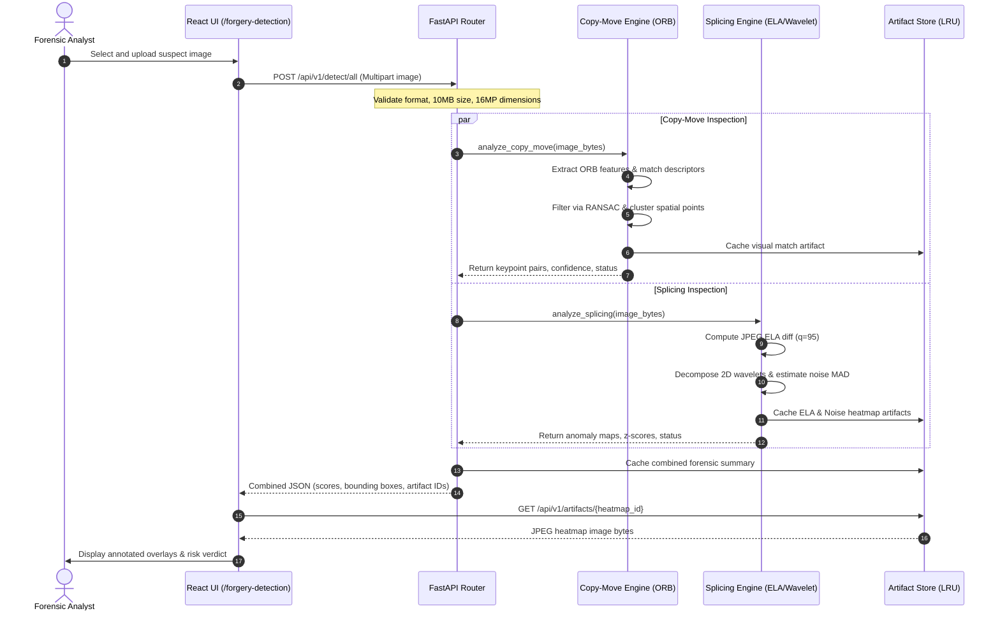
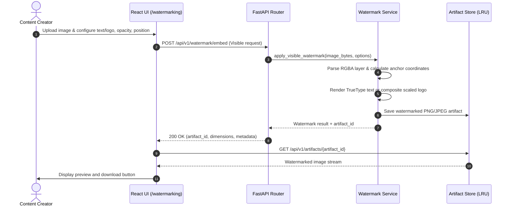
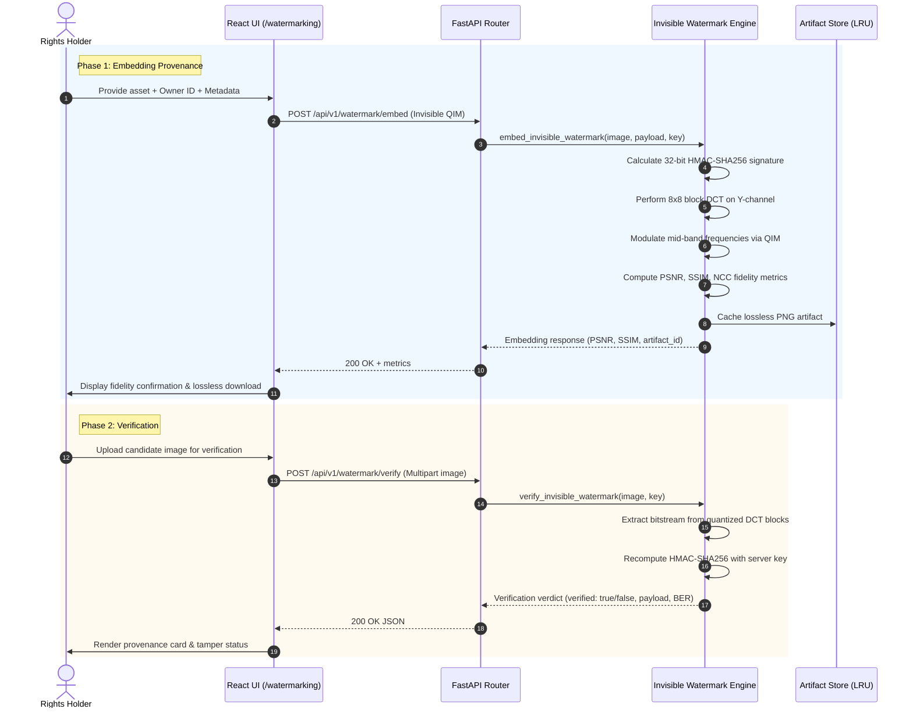

# ImageGuard

[](https://fastapi.tiangolo.com)
[](https://www.python.org)
[](https://react.dev)
[](https://www.typescriptlang.org)
[](https://vitejs.dev)
[](https://tailwindcss.com)
[](https://opencv.org)
[](https://pytest.org)
[](https://vitest.dev)

ImageGuard is an open-source, full-stack digital image integrity platform combining **classical computer vision heuristics for forgery screening** and **dual-mode digital watermarking for provenance and copyright verification**. Built with a FastAPI backend and a React/TypeScript single-page frontend, ImageGuard enables users to inspect suspect images for copy-move cloning and splicing anomalies, as well as stamp and verify visible and imperceptible digital watermarks.

> [!WARNING]
> **Forensic & Evidentiary Disclaimer**: ImageGuard utilizes classical computer vision heuristics (ORB keypoint matching, Error Level Analysis, and wavelet noise residual estimation). These methods are screening tools and indicators designed to assist human analysts; **they do not constitute definitive legal proof of image authenticity or tampering**. Detection results should always be interpreted in context with corroborating metadata and forensic techniques.

---

## Table of Contents

- [Core Capabilities](#core-capabilities)
- [System Architecture](#system-architecture)
- [Technology Stack](#technology-stack)
- [How Forgery Detection Works](#how-forgery-detection-works)
  - [ORB Copy-Move Detection](#1-orb-copy-move-detection)
  - [Splicing Detection (ELA & Wavelet Noise Residuals)](#2-splicing-detection-ela--noise-residuals)
  - [Heuristic Boundaries & Limitations](#detection-heuristic-boundaries)
- [How Watermarking Works](#how-watermarking-works)
  - [Visible Watermark Compositing](#1-visible-watermark-compositing)
  - [Invisible Watermark (DCT-QIM & HMAC-SHA256)](#2-invisible-watermark-dct-qim--hmac-sha256)
- [Workflows & Sequence Diagrams](#workflows--sequence-diagrams)
  - [Forgery Detection Sequence](#forgery-detection-workflow)
  - [Visible Watermark Sequence](#visible-watermark-workflow)
  - [Invisible Watermark Embedding & Verification](#invisible-watermark-workflow)
- [Screenshots & Walkthrough](#screenshots--walkthrough)
- [Installation & Local Development](#installation--local-development)
  - [Prerequisites](#prerequisites)
  - [Backend Setup](#backend-setup)
  - [Frontend Setup](#frontend-setup)
  - [Environment Variables](#environment-variables)
- [REST API Reference](#rest-api-reference)
- [Repository Structure](#repository-structure)
- [Automated Testing & Quality Assurance](#automated-testing--quality-assurance)
- [Operational Constraints & Invariants](#operational-constraints--invariants)
- [Project Roadmap](#project-roadmap)
- [License & Contributions](#license--contributions)

---

## Core Capabilities

ImageGuard is structured around two operational interfaces:

### 1. Forgery Detection Suite (`/forgery-detection`)
- **ORB Keypoint Matching & Spatial Clustering**: Detects cloned patches within the same image by extracting scale-invariant keypoints, matching mutually nearest neighbors, filtering background textures, and segmenting spatial clusters.
- **Affine RANSAC Consistency**: Computes affine transformation models across keypoint pairs to eliminate spurious matches from repetitive textures (e.g., foliage, windows, architectural patterns).
- **Error Level Analysis (ELA)**: Recompresses images at a standardized JPEG quality level (`quality=95`) and computes per-channel absolute pixel differences to expose compression discrepancies indicative of spliced regions.
- **Wavelet Noise Residual Estimation**: Deconstructs image channels using 2D Daubechies (`db2`) wavelets to calculate local Median Absolute Deviation (MAD) noise variance, highlighting spliced donor segments with divergent sensor noise footprints.
- **Unified Risk Assessment**: Aggregates multi-detector findings into normalized confidence metrics and categorical status indicators (`clean`, `inconclusive`, `candidate_regions_found`).

### 2. Watermark Studio (`/watermarking`)
- **Visible Watermark Compositing**: Applies customizable text banners or logo stamps onto images with adjustable opacity, positioning (anchors or exact coordinate offsets), scaling, rotation, padding, and drop-shadow styling.
- **Invisible Provenance Embedding (8x8 Block DCT-QIM)**: Embeds structured metadata payloads (owner ID, asset ID, permissions, ISO timestamp, and an HMAC-SHA256 cryptographic signature) into mid-frequency luminance DCT coefficients using Quantization Index Modulation (QIM).
- **Invisible Watermark Verification**: Extracts and parses embedded bitstreams from watermarked images, verifies payload CRC and cryptographic signatures using the server secret key, and calculates structural quality metrics:
  - **PSNR** (Peak Signal-to-Noise Ratio)
  - **SSIM** (Structural Similarity Index Measure)
  - **NCC** (Normalized Cross-Correlation)
  - **BER** (Bit Error Rate)

---

## System Architecture

ImageGuard operates as a decoupled client-server application. The React SPA communicates with the stateless FastAPI backend over JSON and multipart HTTP REST endpoints. Generated artifacts (annotated masks, heatmaps, watermarked renders) are temporarily cached in an in-memory, thread-safe LRU store without external database dependencies.

```mermaid
flowchart TD
    subgraph Client ["Frontend Client (React 18 + TypeScript + Vite)"]
        UI_Dash["Dashboard / Status Overview"]
        UI_Detect["Forgery Detection Suite\n(Multi-detector view, ELA & Noise maps)"]
        UI_WM["Watermark Studio\n(Visible editor & Invisible QIM manager)"]
        UI_Docs["How It Works & Technical Docs"]
        API_Client["Axios REST Client (`services/api.ts`)"]
        UI_Dash --> API_Client
        UI_Detect --> API_Client
        UI_WM --> API_Client
        UI_Docs --> API_Client
    end

    subgraph Gateway ["FastAPI HTTP Application (`app/main.py`)"]
        CORS["CORS Middleware"]
        V_Limits["Payload & Dimension Validator\n(10 MB upload cap, 16 MP resolution limit)"]
        Router["APIRouter Dispatcher"]
        CORS --> V_Limits --> Router
    end

    subgraph Endpoints ["API Route Handlers (`app/api/`)"]
        R_Detect["`POST /api/v1/detect/all`\n`POST /api/v1/detect/copy-move`\n`POST /api/v1/detect/splicing`"]
        R_WM["`POST /api/v1/watermark/embed`\n`POST /api/v1/watermark/verify`"]
        R_Art["`GET /api/v1/artifacts/{id}`\n`GET /api/v1/health`"]
    end

    subgraph CoreEngine ["Forensic & Vision Engines (`app/services/`)"]
        CM_Eng["Copy-Move Service\n- ORB feature extraction\n- BFMatcher with Hamming distance\n- DBSCAN spatial clustering\n- RANSAC geometric consistency"]
        SP_Eng["Splicing Service\n- Dual-pass JPEG ELA recompression\n- 2D Wavelet (db2) noise extraction\n- Median Absolute Deviation (MAD)\n- Morphological contour filtering"]
        WM_Vis["Visible Watermark Service\n- PIL RGBA layer compositing\n- Dynamic bounding box & alignment\n- Multi-line text & logo overlay"]
        WM_Invis["Invisible Watermark Service\n- YCbCr color transform\n- 8x8 block 2D DCT\n- Mid-frequency QIM bit modulation\n- HMAC-SHA256 signature verification\n- PSNR, SSIM, NCC, BER metrics"]
    end

    subgraph EphemeralStore ["Artifact Store (`app/services/artifact_store.py`)"]
        LRU["In-Memory LRU Cache\n- Default TTL: 900s\n- Max Entries: 40\n- Max Cache Memory: 256 MB\n- Automatic eviction & byte caps"]
    end

    API_Client <--> Gateway
    Router --> R_Detect
    Router --> R_WM
    Router --> R_Art

    R_Detect --> CM_Eng
    R_Detect --> SP_Eng
    R_WM --> WM_Vis
    R_WM --> WM_Invis

    CM_Eng --> LRU
    SP_Eng --> LRU
    WM_Vis --> LRU
    WM_Invis --> LRU
    R_Art <--> LRU
```

### Architectural Principles
1. **Stateless Processing**: Every detection or watermarking request is processed deterministically from input bytes. No persistent relational database or disk write is required.
2. **Ephemeral Artifact Management**: Detection masks, diff heatmaps, and transformed images are stored as in-memory byte buffers in an LRU cache with strict byte limits and time-to-live expiration (15 minutes).
3. **Decoupled Heuristics**: Copy-move detection and splicing estimation execute as independent pipelines that can be invoked individually or orchestrated in parallel.

---

## Technology Stack

### Backend Stack
| Technology / Package | Version | Purpose in ImageGuard |
|:---|:---|:---|
| **Python** | `3.10+` | Core backend runtime |
| **FastAPI** | `0.115.6` | High-performance asynchronous REST API framework |
| **Uvicorn** | `0.34.0` | ASGI web server implementation |
| **OpenCV (`opencv-python-headless`)** | `4.10.0.84` | Keypoint detection (ORB), feature matching, image transformations, morphological filtering |
| **NumPy** | `1.26.4` | Matrix computations, DCT coefficient manipulation, image array processing |
| **SciPy** | `1.14.1` | 2D Discrete Cosine Transform (`scipy.fftpack.dct/idct`), statistical modeling |
| **Pillow (PIL)** | `11.0.0` | Image format transcoding, visible text rendering, RGBA overlay compositing |
| **PyWavelets (`PyWavelets`)** | `1.7.0` | 2D discrete wavelet decomposition for local noise residual estimation |
| **Pydantic / Pydantic-Settings** | `2.10.4` | Strict request/response data validation and type enforcement |
| **Pytest / Pytest-Asyncio** | `8.3.4` | Backend unit, integration, and mathematical test suite |

### Frontend Stack
| Technology / Package | Version | Purpose in ImageGuard |
|:---|:---|:---|
| **React** | `18.3.1` | Component-based declarative user interface |
| **TypeScript** | `5.6.2` | Static type safety and data contract alignment with API schemas |
| **Vite** | `6.0.5` | Fast build tooling and local development server |
| **Tailwind CSS** | `3.4.17` | Utility-first responsive styling and forensic inspection UI layout |
| **Lucide React** | `0.468.0` | Iconography for forensic indicators, tools, and visual cues |
| **Axios** | `1.7.9` | Promise-based HTTP client for multipart and JSON API communication |
| **Vitest** | `2.1.8` | Frontend unit and component integration testing |
| **Testing Library (React / Jest-DOM)** | `16.1.0` | DOM assertion and user-event simulation |

---

## How Forgery Detection Works

### 1. ORB Copy-Move Detection
Copy-move forgery involves duplicating a region of an image and pasting it into another location to conceal an object or duplicate an element.

```
Input Image ──► Grayscale Conversion ──► ORB Keypoint Extraction
                                                    │
                                                    ▼
Candidate Regions ◄── DBSCAN Spatial ◄── RANSAC Affine ◄── BFMatcher (Hamming)
   & Heatmaps          Clustering         Validation         + Ratio Test
```

1. **Feature Extraction**: The input image is converted to grayscale, and ORB (Oriented FAST and Rotated BRIEF) extracts up to 2,000 scale-invariant, rotation-aware keypoints and 256-bit binary descriptors.
2. **Descriptor Matching**: A Brute-Force Matcher with Hamming distance computes all pairwise descriptor similarities. Trivial self-matches and matches separated by fewer than 20 pixels are filtered out.
3. **Lowe's Ratio Test**: For each keypoint, the ratio of the nearest neighbor distance to the second-nearest neighbor distance is validated ($\text{ratio} < 0.75$) to reject ambiguous matches.
4. **Geometric RANSAC Filtering**: Affine transformation estimation via RANSAC is applied to sets of matched pairs. Matched pairs that do not fit a coherent affine transformation model are discarded as background texture noise (e.g., foliage, repeating windows).
5. **Spatial Clustering**: DBSCAN (Density-Based Spatial Clustering of Applications with Noise) groups remaining geometrically consistent keypoints into candidate donor and clone regions, generating bounding boxes and forensic visualization overlays.

### 2. Splicing Detection (ELA & Noise Residuals)
Image splicing combines components from two or more distinct images. Because different source images typically possess divergent compression histories and sensor noise footprints, ImageGuard applies dual heuristic analysis:

#### A. Error Level Analysis (ELA)
1. The image is resaved in memory as a standard JPEG at 95% quality.
2. The absolute difference between the incoming pixel array and the recompressed pixel array is computed per channel:
   $$\Delta I(x, y) = |I_{\text{orig}}(x, y) - I_{\text{recompressed}}(x, y)|$$
3. Differences are scaled by an amplification multiplier ($10\times$) to normalize low-amplitude variations into visible dynamic ranges.
4. Areas with anomalous error distribution relative to surrounding uniform blocks indicate differing recompression cycles or spliced post-processing.

#### B. Wavelet Noise Residual Analysis
1. The green/luminance channel is extracted and decomposed using a 2D Daubechies wavelet transform (`db2`).
2. High-frequency subbands ($HH, HL, LH$) isolate high-frequency stochastic variations while stripping semantic edge structure.
3. The local noise variance $\sigma_n$ is estimated across overlapping blocks using the Median Absolute Deviation (MAD):
   $$\hat{\sigma} = \frac{\text{median}(|W - \text{median}(W)|)}{0.6745}$$
4. Standardized z-scores of local noise variance highlight regional boundaries where sensor noise floor deviates sharply from the host image baseline.

### Detection Heuristic Boundaries
- **Recompression Limitations**: If a spliced image has been repeatedly resaved or uniformly compressed at low quality ($\le 70$), ELA error discrepancies may flatten, producing false negatives.
- **Micro-Textures**: High-frequency natural textures (e.g., gravel, water ripples, grass) exhibit elevated noise residuals that can occasionally trigger false positives without secondary review.
- **Copy-Move Transformation Tolerance**: ORB keypoints withstand moderate rotation ($\le 45^\circ$) and scaling ($0.8\times - 1.2\times$). Highly warped, non-affine, or heavily blurred cloned patches may not meet keypoint density thresholds.

---

## How Watermarking Works

### 1. Visible Watermark Compositing
Visible watermarking provides immediate attribution and determent against unauthorized reuse.
- **Text Rendering**: Uses Pillow's TrueType font rendering engine to composite arbitrary strings with user-controlled point size, color, alpha transparency ($0.0 - 1.0$), and dynamic drop-shadow offsets.
- **Anchor Positioning**: Supports 9 anchor points (`top-left`, `top-center`, `top-right`, `center`, `bottom-left`, `bottom-center`, `bottom-right`, etc.) or absolute coordinate offsets with automatic boundary padding.
- **Logo Stamping**: Supports uploading secondary image assets as logos, with proportional resizing, rotational transforms, and alpha blending onto the base image.

### 2. Invisible Watermark (DCT-QIM & HMAC-SHA256)
For imperceptible copyright tracking and provenance verification, ImageGuard implements a frequency-domain Quantization Index Modulation scheme:

```
Payload (Owner ID + Timestamp + Metadata) ──► Append HMAC-SHA256 (32 bits)
                                                         │
                                                         ▼
Watermarked Image ◄── Inverse DCT ◄── Quantize QIM ◄── 8x8 2D DCT on Y-Channel
```

1. **Color Space Conversion**: The RGB image is converted to YCbCr. The luminance ($Y$) channel is partitioned into non-overlapping $8 \times 8$ pixel blocks.
2. **Discrete Cosine Transform (DCT)**: Each $8 \times 8$ block is transformed into frequency space using 2D DCT.
3. **Payload Framing & Authentication**:
   - The user payload string (e.g., owner ID, licensing terms, creation timestamp) is converted to binary.
   - A 32-bit truncation of an **HMAC-SHA256** signature is calculated using the payload and server secret key (`IMAGEGUARD_WATERMARK_KEY`).
   - A 16-bit synchronization preamble and payload length header are prefixed to the bitstream.
4. **Quantization Index Modulation (QIM)**:
   - Selected mid-frequency DCT coefficients (balancing imperceptibility and robustness against mild compression) are quantized with step size $\Delta$:
     $$C'(u, v) = \text{round}\left(\frac{C(u, v)}{\Delta} - \frac{b}{2}\right) \cdot \Delta + \frac{b}{2} \cdot \Delta$$
     where $b \in \{0, 1\}$ is the bit to embed.
5. **Reconstruction**: The modified $Y$ channel undergoes inverse 2D DCT (`idct`), is recombined with $Cb$ and $Cr$ channels, and is saved in lossless PNG format to preserve coefficient precision.
6. **Verification & Quality Metrics**:
   - During verification, the bitstream is extracted by testing quantization parity.
   - The HMAC signature is recomputed against `IMAGEGUARD_WATERMARK_KEY`. If the signature matches, authenticity is confirmed.
   - Full-reference fidelity metrics are calculated against the original asset:
     - **PSNR**: Typically $\ge 42.0\text{ dB}$ (imperceptible to the human eye).
     - **SSIM**: Typically $\ge 0.995$.
     - **BER**: Ratio of corrupted payload bits extracted under test conditions.

---

## Workflows & Sequence Diagrams

### Forgery Detection Workflow


### Visible Watermark Workflow


### Invisible Watermark Workflow


---

## Screenshots & Walkthrough

*(Below are the recommended screenshot placements and capture instructions when generating documentation media for ImageGuard).*

| View / Feature | Preview / Location | Description & Capture Steps |
|:---|:---|:---|
| **System Dashboard** | `docs/screenshots/dashboard.png` *(placeholder)* | Navigate to `/`. Displays overview metric cards, system readiness indicators, and direct navigation actions. |
| **Forgery Detection Suite** | `docs/screenshots/forgery_detection.png` *(placeholder)* | Navigate to `/forgery-detection`. Upload an image with cloned elements to display candidate bounding boxes, ORB keypoint vectors, and side-by-side ELA error heatmaps. |
| **Visible Watermark Studio** | `docs/screenshots/watermark_visible.png` *(placeholder)* | Navigate to `/watermarking`. Select "Visible Watermark", enter copyright text or upload a logo, adjust alpha opacity slider to 65%, and view the live canvas overlay. |
| **Invisible Watermark & Metrics** | `docs/screenshots/watermark_invisible.png` *(placeholder)* | Navigate to `/watermarking` -> "Invisible Watermark". Embed metadata payload, inspect computed PSNR ($\ge 42\text{ dB}$) and SSIM ($\ge 0.99$), and run the verification check. |

---

## Installation & Local Development

### Prerequisites
- **Python**: version `3.10` or higher (`python3 --version`)
- **Node.js**: version `18.0.0` or higher (`node --version`)
- **npm**: version `9.0.0` or higher (`npm --version`)
- **Git**

### Automated Setup
ImageGuard includes initialization scripts in the `scripts/` directory:

```bash
# Clone the repository
git clone https://github.com/abhiveeramallu/Image_Guard.git
cd Image_Guard

# Run the automated environment setup (creates venv, installs Python & npm packages)
chmod +x scripts/*.sh
./scripts/setup.sh
```

### Manual Setup

#### 1. Backend Setup
```bash
# Create and activate a Python virtual environment
python3 -m venv backend/.venv
source backend/.venv/bin/activate  # On Windows: backend\.venv\Scripts\activate

# Upgrade pip and install dependencies
pip install --upgrade pip
pip install -r backend/requirements.txt
pip install -r backend/requirements-dev.txt

# Create local environment file
cp backend/.env.example backend/.env

# Launch the FastAPI backend development server
uvicorn app.main:app --app-dir backend --host 127.0.0.1 --port 8000 --reload
```
The backend API documentation is interactively accessible at:
- Swagger UI: `http://localhost:8000/docs`
- ReDoc: `http://localhost:8000/redoc`

#### 2. Frontend Setup
In a separate terminal:
```bash
cd frontend

# Install npm dependencies
npm install

# Start the Vite development server
npm run dev
```
The React frontend will be accessible at `http://localhost:5173`. Requests to `/api` are automatically proxied to the backend at `http://localhost:8000`.

### Environment Variables

Configure backend options in `backend/.env` (or via process environment variables):

| Variable | Type | Default Value | Description |
|:---|:---|:---|:---|
| `IMAGEGUARD_ENV` | String | `development` | Environment mode (`development`, `production`, `test`) |
| `IMAGEGUARD_HOST` | String | `127.0.0.1` | Network interface for FastAPI to bind |
| `IMAGEGUARD_PORT` | Integer | `8000` | Port for FastAPI web server |
| `IMAGEGUARD_CORS_ORIGINS` | JSON list | `["http://localhost:5173","http://127.0.0.1:5173"]` | Allowed CORS origins for browser client access |
| `IMAGEGUARD_MAX_UPLOAD_BYTES`| Integer | `10485760` (10 MB) | Maximum permitted size for uploaded image files |
| `IMAGEGUARD_MAX_IMAGE_PIXELS`| Integer | `16000000` (16 MP) | Maximum allowable total pixels ($W \times H$) to prevent decompression exhaustion |
| `IMAGEGUARD_ARTIFACT_TTL_SECONDS` | Integer | `900` (15 min) | Time-to-live for cached masks and renders in LRU store |
| `IMAGEGUARD_ARTIFACT_MAX_ENTRIES` | Integer | `40` | Maximum distinct artifacts retained simultaneously in memory |
| `IMAGEGUARD_ARTIFACT_MAX_TOTAL_MB`| Integer | `256` | Maximum aggregate memory allocated to in-memory artifact caching |
| `IMAGEGUARD_WATERMARK_KEY` | String | `imageguard-default-secret-key-change-me` | Secret cryptographic key used to generate and verify HMAC-SHA256 signatures for invisible watermarks |

---

## REST API Reference

All API routes are prefixed with `/api/v1`.

| Method | Endpoint | Content-Type | Request Parameters / Body | Description | Response Model / Output |
|:---|:---|:---|:---|:---|:---|
| `GET` | `/health` | `application/json` | None | Service liveness probe and component readiness check | `{"status": "healthy", ...}` |
| `POST` | `/api/v1/detect/all` | `multipart/form-data` | `image: UploadFile` | Executes copy-move and splicing detectors in parallel | `UnifiedDetectionResponse` (composite scores, boxes, artifact IDs) |
| `POST` | `/api/v1/detect/copy-move` | `multipart/form-data` | `image: UploadFile` | Runs ORB feature matching and RANSAC affine clustering | `CopyMoveResponse` (matched keypoint pairs, candidate clusters) |
| `POST` | `/api/v1/detect/splicing` | `multipart/form-data` | `image: UploadFile` | Runs JPEG ELA recompression and wavelet noise residual estimation | `SplicingResponse` (anomaly score, ELA & noise heatmap IDs) |
| `POST` | `/api/v1/watermark/embed` | `multipart/form-data` | `image: UploadFile`, `config: JSON string` | Embeds visible text/logo or invisible QIM watermark payload | `WatermarkEmbedResponse` (artifact ID, PSNR/SSIM metrics if invisible) |
| `POST` | `/api/v1/watermark/verify` | `multipart/form-data` | `image: UploadFile` | Extracts and cryptographically verifies invisible QIM watermark payload | `WatermarkVerifyResponse` (verified: bool, payload string, BER) |
| `GET` | `/api/v1/artifacts/{id}` | Varying | Path parameter `id: str` | Retrieves an ephemeral image artifact (heatmap, annotated visualizer) from LRU cache | Binary image stream (`image/png` or `image/jpeg`) |

---

## Repository Structure

```
Image_Guard/
├── backend/
│   ├── app/
│   │   ├── api/                     # REST API route controllers
│   │   │   ├── routes_artifacts.py  # Cache retrieval endpoints
│   │   │   ├── routes_detect.py     # Forgery detection endpoints (copy-move, splicing, unified)
│   │   │   └── routes_watermark.py  # Visible and invisible watermarking endpoints
│   │   ├── core/                    # Core system configuration & error handling
│   │   │   ├── config.py            # Pydantic BaseSettings and environment mappings
│   │   │   ├── exceptions.py        # Domain-specific exception definitions
│   │   │   └── security.py          # Cryptographic hashing & payload signing routines
│   │   ├── models/                  # Pydantic schemas for request & response contracts
│   │   │   ├── schemas_detect.py    # Detection payload and metric structures
│   │   │   └── schemas_watermark.py # Watermarking configuration schemas
│   │   ├── services/                # Computer vision and digital signal algorithms
│   │   │   ├── artifact_store.py    # In-memory thread-safe LRU cache with TTL eviction
│   │   │   ├── copy_move_service.py # ORB keypoint matching, RANSAC, and spatial clustering
│   │   │   ├── invisible_watermark_service.py # 8x8 DCT-QIM embedder/extractor & fidelity metrics
│   │   │   ├── splicing_service.py  # Dual-pass JPEG ELA & 2D wavelet noise residual estimator
│   │   │   └── watermark_service.py # Visible PIL overlay compositing & positioning
│   │   └── main.py                  # FastAPI application factory, CORS, and lifecycle setup
│   ├── tests/                       # Comprehensive test suite (169 tests)
│   │   ├── conftest.py              # Test fixtures and synthesized test images
│   │   ├── test_api_detect.py       # Detection route integration tests
│   │   ├── test_api_watermark.py    # Watermark route integration tests
│   │   ├── test_artifact_store.py   # LRU eviction and memory budget tests
│   │   ├── test_copy_move.py        # Copy-move algorithmic precision tests
│   │   ├── test_invisible_watermark.py # DCT-QIM embedding, recovery, & BER tests
│   │   └── test_splicing.py         # ELA and wavelet noise residual tests
│   ├── requirements.txt             # Production Python dependencies
│   └── requirements-dev.txt         # Testing and development dependencies
├── frontend/
│   ├── src/
│   │   ├── components/              # Shared UI components
│   │   │   ├── layout/              # Header, navigation, and page containers
│   │   │   └── ui/                  # Reusable badges, buttons, cards, sliders, file drops
│   │   ├── pages/                   # Application views
│   │   │   ├── DashboardPage.tsx    # High-level overview and platform health
│   │   │   ├── ForgeryDetectionPage.tsx # Inspection workspace for copy-move & splicing
│   │   │   ├── HowItWorksPage.tsx   # Detailed technical guides and algorithmic theory
│   │   │   └── WatermarkingPage.tsx # Visible studio & invisible watermark workspace
│   │   ├── services/
│   │   │   └── api.ts               # Axios REST client with complete type coverage
│   │   ├── types/
│   │   │   ├── detection.ts         # TypeScript definitions for detection responses
│   │   │   └── watermark.ts         # TypeScript definitions for watermark options
│   │   ├── App.tsx                  # Root client routing and layout tree
│   │   └── main.tsx                 # DOM initialization entry point
│   ├── package.json                 # Frontend dependencies and run scripts
│   ├── tsconfig.json                # TypeScript compiler configuration
│   └── vite.config.ts               # Vite build configuration and API reverse proxy
├── docs/                            # Supplementary architectural and algorithmic documentation
└── scripts/                         # Operational helper scripts
    ├── dev-backend.sh               # Starts local backend with reload
    ├── dev-frontend.sh              # Starts local Vite development server
    ├── setup.sh                     # Automated environment provisioning
    └── test-all.sh                  # Runs backend pytest and frontend vitest suites
```

---

## Automated Testing & Quality Assurance

ImageGuard maintains rigorous test suites covering edge cases (zero dimensions, empty payloads, corrupted bitstreams, boundary coordinate clipping, and high-frequency false positives):

### Backend Verification (Pytest)
```bash
# Activate virtual environment
source backend/.venv/bin/activate

# Execute the 169 backend unit and integration tests
pytest backend/tests -v
```
**Results**: `169 passed in ~23s` (100% test pass rate).

### Frontend Verification (Vitest & TypeScript)
```bash
cd frontend

# Run TypeScript typecheck
npm run typecheck

# Run Vitest unit & component test suite
npm test -- --run

# Run production build verification
npm run build
```
**Results**: `47 passed across 6 test suites`, `0 TypeScript compiler errors`, clean production bundle created in ~500ms.

### Unified Test Runner
To execute both test suites in sequence:
```bash
./scripts/test-all.sh
```

---

## Operational Constraints & Invariants

To guarantee operational stability and protect against Denial of Service (DoS) attack vectors through resource exhaustion, ImageGuard enforces the following hard constraints:

1. **Max Upload Size**: Requests containing individual files exceeding `10 MB` (`10,485,760 bytes`) are rejected immediately with HTTP `413 Payload Too Large`.
2. **Decompression Bomb Protection**: Input images exceeding `16,000,000 pixels` (16 Megapixels, e.g., $4000 \times 4000$) are rejected with HTTP `400 Bad Request` prior to loading uncompressed pixel arrays into memory.
3. **In-Memory Store Eviction**: The ephemeral artifact cache operates under an LRU eviction policy capped at 40 concurrent items and a maximum of 256 MB. Artifacts are automatically destroyed after 900 seconds (15 minutes).
4. **Watermark Key Isolation**: The invisible watermarking scheme relies on `IMAGEGUARD_WATERMARK_KEY` to authenticate HMAC-SHA256 signatures. In production deployments, this key must be set to a cryptographically secure random value and kept confidential.

---

## Project Roadmap

- [x] Classical ORB copy-move detection with RANSAC geometric filtering
- [x] Dual-pass JPEG Error Level Analysis (ELA)
- [x] 2D Daubechies wavelet noise residual extraction
- [x] Visible watermark compositing with custom TrueType font and logo overlays
- [x] Invisible 8x8 block DCT-QIM embedding with HMAC-SHA256 authentication
- [x] Ephemeral in-memory LRU artifact caching
- [ ] **Batch Processing Mode**: Support multi-image directory inspection for forensic audits.
- [ ] **Deep Learning-Based Localization**: Optional integration of pre-trained deep neural networks (e.g., ManTra-Net or TruFor) for non-rigid splicing localization.
- [ ] **EXIF & Metadata Forensic Parser**: Analysis of standard and non-standard EXIF tags, thumbnail mismatches, and quantization table fingerprinting.
- [ ] **Spatial LSB Watermarking Mode**: Low-complexity spatial domain embedding for lightweight verification pipelines.

---

## License & Contributions

### License
*Note: A formal open-source license file (such as MIT or Apache 2.0) has not yet been committed to this repository. All rights are reserved by the repository owner until a `LICENSE` file is explicitly established.*

### Contributing
Contributions, issue reports, and feature proposals are welcome:
1. Fork the repository.
2. Create an isolated feature branch: `git checkout -b feature/improved-feature-matching`.
3. Ensure all backend tests pass (`pytest backend/tests`) and frontend tests pass (`npm test`).
4. Commit your changes with clear, descriptive commit messages.
5. Submit a pull request detailing the changes and relevant forensic rationale.
